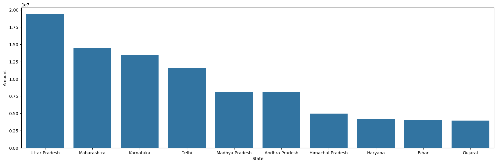
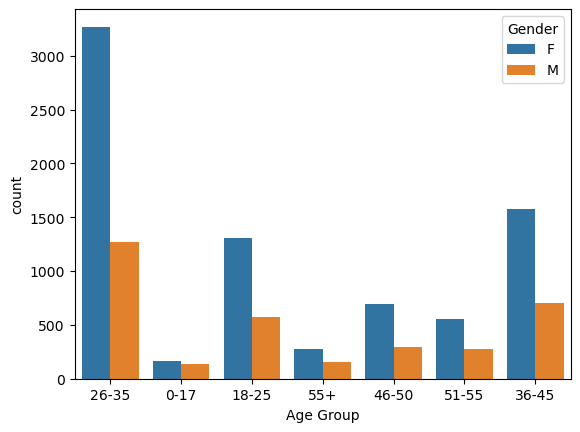
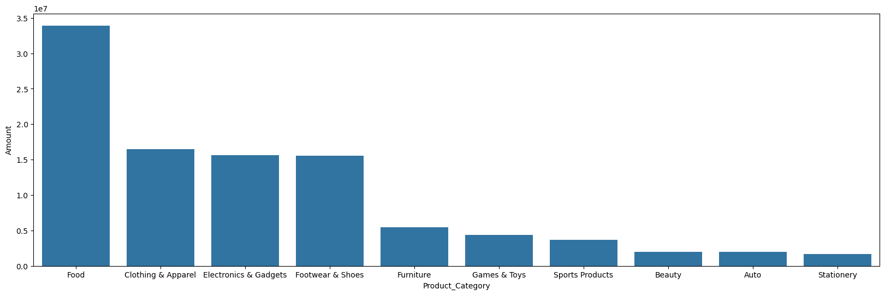

# 🛍️ Sales Data Exploratory Data Analysis | Python & EDA

> An in-depth Exploratory Data Analysis (EDA) on **11,250+ sales transactions** to uncover customer demographics, regional sales trends, and top-performing product categories.


---

## 📌 Project Overview

This project analyzes a retail sales dataset containing over **11,000 transactions** across various Indian states. The goal was to clean the raw data, handle missing values, and perform exploratory data analysis to answer key business questions: *Who is our target audience? Which states generate the most revenue? What product categories and occupations drive the most sales?*

Using **Python (Pandas, NumPy, Matplotlib, Seaborn)**, I transformed raw transactional data into actionable business insights.

---

## 💡 Key Business Insights (The "So What?")

- **👥 Target Demographic**: The **26-35 age group** is the primary customer base. Furthermore, **Female** shoppers make up the majority of purchases compared to male shoppers.
- **🗺️ Regional Dominance**: **Uttar Pradesh**, **Maharashtra**, and **Karnataka** are the top 3 states in terms of both order volume and total sales amount.
- **🛒 Top Product Categories**: **Clothing & Apparel** and **Food** are the highest-grossing product categories, followed closely by Electronics and Footwear.
- **💼 High-Value Occupations**: Professionals working in **IT**, **Healthcare**, and **Aviation** generate the highest sales revenue.
- **💍 Marital Status Impact**: Married customers (especially married women) account for a significantly higher share of the total purchase amount compared to unmarried customers.

---

## 🖼️ Visualizations

**1. Top 10 States by Sales Amount**
*Uttar Pradesh and Maharashtra lead the way in total revenue generated.*


**2. Customer Demographics (Age Group & Gender)**
*The 26-35 age bracket dominates the market, with female buyers driving the majority of sales.*


**3. Top Product Categories by Revenue**
*Clothing and Food are the most lucrative segments in the dataset.*


---

## 🛠️ Tech Stack & Methodology

| **Category** | **Tools & Techniques** |
| :--- | :--- |
| **Language** | Python |
| **Data Manipulation** | Pandas, NumPy |
| **Data Visualization** | Matplotlib, Seaborn |
| **Techniques** | Data Cleaning, Handling Null Values, Data Type Conversion, GroupBy Aggregations, EDA |

**Data Cleaning Steps Performed:**
1. **Dropped Irrelevant Columns**: Removed completely empty columns (`Status`, `unnamed1`).
2. **Handled Missing Values**: Identified 12 null values in the `Amount` column and dropped them to ensure accurate calculations.
3. **Data Type Conversion**: Converted the `Amount` column from Float to Integer for cleaner reporting.

---

## 📂 Repository Structure

```plaintext
SALES_DATA_EDA/
│
├── README.md
├── selfdataprojectpython.ipynb  ← Jupyter Notebook (Full code & analysis)
├── salesdata.csv                ← Raw dataset
└── plot1.png, plot2.png, etc.   ← Exported visualizations
